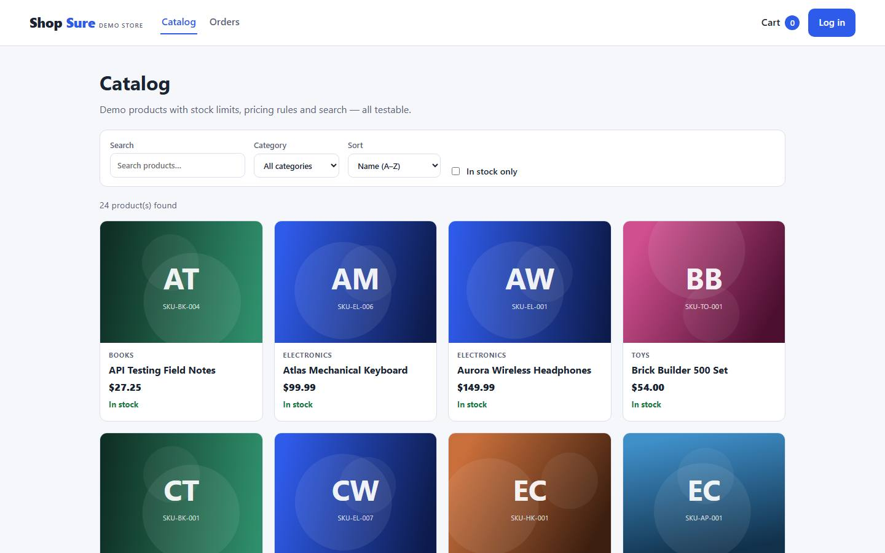
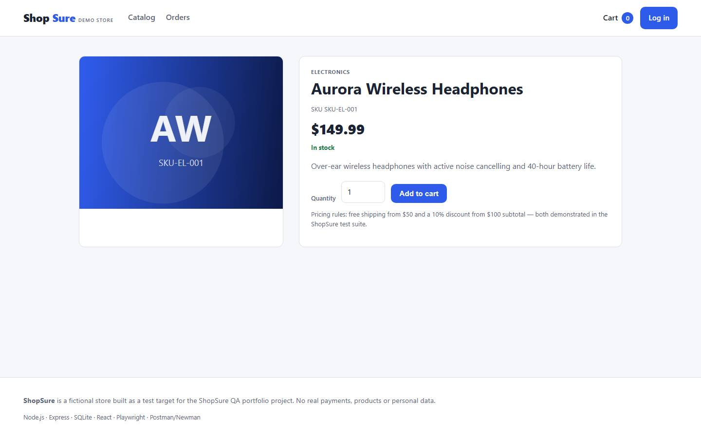
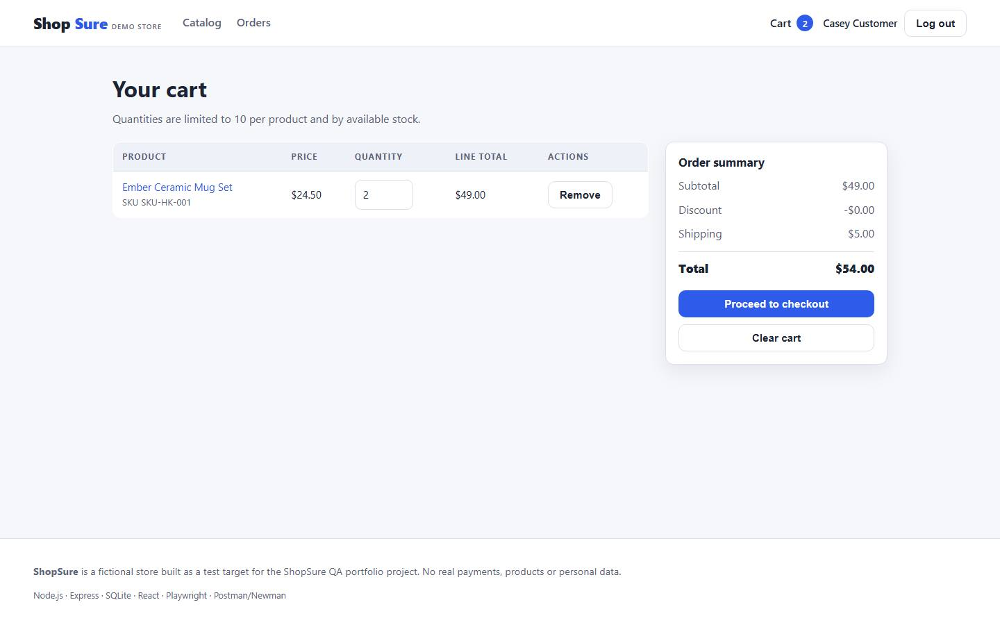
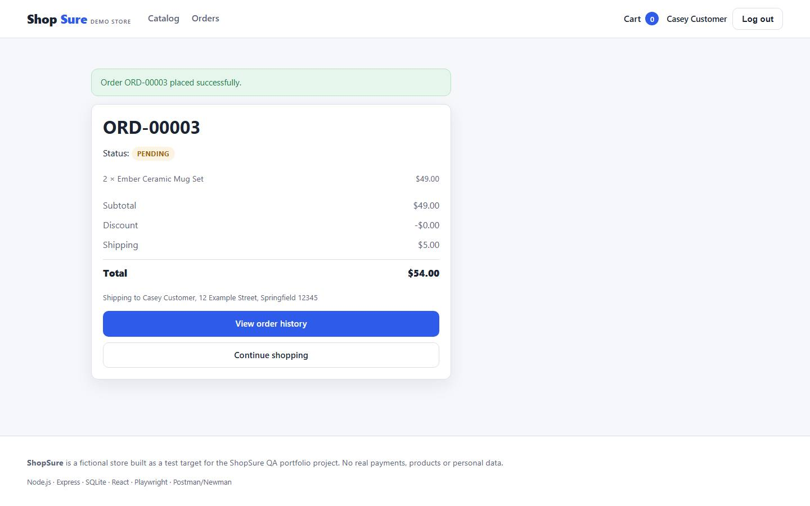

# ShopSure — E-commerce Quality Assurance and Test Automation

<p align="left">
  <strong>Portfolio QA project 1 of 3</strong> · manual testing · API testing · UI automation · database validation
</p>

> **ShopSure is a fictional demo store** built specifically as a test target for this QA portfolio.
> There is no real payment processing, no real customer data and no commercial relationship with any
> e-commerce platform. All users, products and orders are synthetic seed data.

| | |
|---|---|
| **Stack** | Node.js 24 · Express 4 · `node:sqlite` · Zod · React 18 + Vite 5 (TypeScript) |
| **Test tools** | Playwright (API + UI) · Postman + Newman · SQL checks via `node:sqlite` |
| **Manual cases** | 101 (99 executed and passed, 2 documented as not executed) |
| **Automated** | 202 checks: 72 API · 31 UI · 23 SQL · 76 Postman assertions — **all passing** |
| **Requirements** | 24 with acceptance criteria · 100% traced to executed test cases |
| **Defects** | 3 genuinely found (fixed, retested) · 3 deliberately seeded (detection proven) |
| **Last full run** | 2026-10-13 · see [`test-reports/execution-report-latest.md`](test-reports/execution-report-latest.md) |

---

## 1. Project overview

ShopSure is a small but realistic e-commerce application: a customer storefront (React SPA) and a REST API
(Express + SQLite) behind it. It exists so that a complete QA lifecycle can be practised and evidenced:
requirements → test design → manual, API, UI, database and exploratory execution → defect management →
evidence-based release reporting.

The application deliberately contains the kind of rules that create interesting tests: quantity limits,
stock races, pricing thresholds, role-based access and an order state machine.

## 2. Business problem

An online store only works if a handful of rules always hold: customers must not be able to buy more than
exists, prices must be calculated exactly as the business specifies, orders must never enter impossible
states, and one customer must never see another customer's data. This project treats those rules as the
primary risk and builds the test strategy around them.

## 3. Objectives and testing scope

**Objectives**

1. Verify functional correctness of the storefront and the REST API.
2. Prove the business rules at their exact boundaries (stock, quantities, pricing, statuses).
3. Prove authorization is enforced server-side for every admin endpoint and every customer-owned resource.
4. Prove stored data stays consistent even when operations fail.
5. Deliver repeatable automation that a CI pipeline can run on every change.

**In scope:** registration/login/sessions, catalog search/filter/sort/pagination, cart rules, checkout
validation, pricing, stock handling, order lifecycle and history, cancellation, admin workflow, inventory
management, RBAC, database constraints/integrity/audit, selected security and usability checks.

**Out of scope:** real payments, email/SMS delivery, load testing (see the TaskFlow project for the
performance baseline), cross-browser certification (Chromium only here) and full WCAG auditing.

## 4. Architecture and technology

```
┌──────────────────────────┐        ┌────────────────────────────────────────┐
│  React 18 SPA (Vite/TS)  │  HTTP  │  Express 4 REST API  (/api/*)          │
│  app/web                 │ ─────▶ │  app/server/src                        │
│  • catalog, cart,        │ cookie │  • zod validation + error envelope     │
│    checkout, orders,     │ session│  • scrypt passwords, DB-backed sessions│
│    admin console         │        │  • server-side RBAC                    │
└──────────────────────────┘        └───────────────┬────────────────────────┘
        ▲        built into app/web/dist            │ node:sqlite (no native deps)
        │        and served by Express              ▼
┌──────────────────────────┐        ┌────────────────────────────────────────┐
│ Playwright (UI + API)    │        │  SQLite database                       │
│ Postman / Newman         │        │  users · sessions · categories ·       │
│ SQL validation scripts   │        │  products · cart_items · orders ·      │
└──────────────────────────┘        │  order_items · order_events            │
                                    └────────────────────────────────────────┘
```

**Why this stack:** Node's built-in `node:sqlite` needs no native compilation (so CI and Windows both
work out of the box), Express keeps the API small and readable, and Zod makes validation failures produce
consistent field-level errors that tests can assert precisely.

## 5. Features under test

Registration · login/logout/session · brute-force throttling · product listing · search (with LIKE
escaping) · sorting · filtering · pagination · product detail · cart add/merge · cart quantity and stock
limits · cart update/remove/clear · cart ownership · checkout form validation · pricing decision table ·
stock re-validation at checkout · order creation · order history and isolation · order cancellation with
stock restore · admin order status workflow · admin inventory management · RBAC · audit events · empty,
loading and error states · mobile layout.

## 6. Requirements and acceptance criteria

- 24 requirements with 72 acceptance criteria: [`test-documentation/requirements.md`](test-documentation/requirements.md)
- Acceptance criteria with linked test cases: [`test-documentation/acceptance-criteria.md`](test-documentation/acceptance-criteria.md)
- Both are generated from the single source of truth in `test-data/tests/requirements.mjs`.

## 7. Test strategy

[`test-documentation/test-strategy.md`](test-documentation/test-strategy.md) explains the risk-based
approach: four risks (pricing boundaries, stock integrity, authorization, state machine) drive the design;
decision tables, boundary analysis, state-transition testing, role matrix testing and exploratory charters
are the techniques; entry/exit and suspension criteria are defined explicitly.

## 8. Test case organisation

[`test-documentation/test-cases.csv`](test-documentation/test-cases.csv) — 101 cases with IDs
`SHOP-TC-001..101` and requirement links `SHOP-REQ-001..024`. Columns: ID, requirement, module, scenario,
preconditions, test data, numbered steps, expected result, actual result, status, priority, test type,
environment, defect ID, evidence link, notes.

| Type | Count | Type | Count |
|------|-------|------|-------|
| Functional | 24 | Security | 12 |
| Boundary | 16 | Database | 7 |
| Negative | 12 | Regression | 5 |
| Validation | 6 | Usability/Accessibility | 7 |
| Smoke | 3 | Exploratory | 2 |
| Integration | 3 | Data integrity | 4 |

Traceability: [`test-documentation/traceability-matrix.csv`](test-documentation/traceability-matrix.csv)
(24 requirements → test cases, 100% fully covered).
Scenarios and decision tables: [`test-documentation/test-scenarios.md`](test-documentation/test-scenarios.md).

## 9. API testing approach

- 24 endpoints documented with their status-code contracts in
  [`test-documentation/api-test-plan.md`](test-documentation/api-test-plan.md).
- **72 Playwright API tests** ([`tests/api`](tests/api)) using real sessions, real cookies and a real database.
- **Postman collection** ([`postman/ShopSure-API.postman_collection.json`](postman/ShopSure-API.postman_collection.json))
  with an environment **template** (placeholders only — no secrets) and 76 assertions, executed via Newman
  in the pipeline and by hand in the Postman UI.
- Error envelope, `X-Total-Count`, pagination contract and business-rule codes are asserted, not assumed.

## 10. UI automation approach

- **31 Playwright UI tests** ([`tests/ui`](tests/ui)) across catalog, authentication, purchase journey,
  administration and accessibility.
- Stable `data-testid` hooks, no arbitrary sleeps, web-first assertions, traces/screenshots on failure.
- `@smoke` and `@regression` tagged subsets for fast vs full runs.
- Details and examples: [`test-documentation/ui-automation.md`](test-documentation/ui-automation.md).

## 11. Database testing approach

- **23 SQL checks** ([`tests/db/constraints.mjs`](tests/db/constraints.mjs)): CHECK/UNIQUE constraints,
  foreign-key integrity, orphan detection, pricing consistency, order-number format/uniqueness, credential
  storage, session expiry and audit-event completeness.
- The checks run **after** the API/UI suites without a reset, so they also validate real user-generated data.
- Details and sample queries: [`test-documentation/database-testing.md`](test-documentation/database-testing.md).

## 12. Install and run the application

Requirements: Node.js ≥ 20.11 (developed on 24.21.0). No compilers, no Docker, no external database.

```powershell
cd projects/shopsure-qa
npm install
npm run build        # build the React SPA into app/web/dist
npm run db:reset     # deterministic seed: 6 categories, 24 products, 3 users, 2 orders
npm start            # http://127.0.0.1:4100
```

Demo accounts (synthetic, documented — not secrets):

| Role | Email | Password |
|------|-------|----------|
| Customer | `customer@example.com` | `Customer#12345` |
| Customer (isolation tests) | `second@example.com` | `Second#12345` |
| Administrator | `admin@example.com` | `Admin#12345` |

Development mode with hot reload for the SPA: run `npm start` in one terminal and
`npx vite --config app/web/vite.config.ts` in another (the Vite dev server proxies `/api` to port 4100).

Environment variables are documented in [`.env.example`](.env.example) (`PORT`, `DB_PATH`, `NODE_ENV`,
`APP_SECRET`, `SEED_DEFECTS`).

## 13. Run each test suite

```powershell
npm run test:api             # 72 Playwright API tests (auto-starts a seeded server on 4180)
npm run test:ui              # 31 Playwright UI tests (Chromium)
npm run test:smoke           # @smoke tagged subset
npm run test:regression      # @regression tagged subset
npm run test:db              # 23 SQL validation checks
npm run test:postman         # 35-request Postman collection via Newman
npm run test:all             # everything + report generation
npm run test:seeded-defects   # proves the suite detects the 3 injected defects
npm run screenshots           # captures UI evidence into test-evidence/screenshots/
npm run docs:csv              # regenerates the CSV/markdown deliverables
npm run docs:report           # regenerates the execution report from raw results
npm run lint                  # ESLint over app, tests and scripts
npm run typecheck:web         # TypeScript check of the SPA
```

If Playwright browsers are missing: `npx playwright install chromium`.

## 14. Where the reports live

| Artefact | Location |
|----------|----------|
| Execution report (human) | [`test-reports/execution-report-latest.md`](test-reports/execution-report-latest.md) |
| Machine-readable summary | [`test-reports/summary.json`](test-reports/summary.json) |
| Playwright JSON/HTML reports | `test-reports/playwright/` (HTML: `.../html/index.html`) |
| SQL check results | `test-reports/db-checks.json` |
| Newman results | `test-reports/newman/` |
| Raw command logs | `test-evidence/logs/` |
| Screenshots | [`test-evidence/screenshots/`](test-evidence/screenshots/) |
| Manual/exploratory evidence | `test-evidence/logs/manual-execution-latest.md` |
| Seeded-defect detection evidence | `test-evidence/seeded-defects/` |

## 15. Actual execution results

**Last full run: 2026-10-13** (`npm run test:all`, commit `1f9605a`, Node v24.21.0, Windows 11).

| Suite | Result | Details |
|-------|--------|---------|
| Playwright API | **72 / 72 passed** | 0 failed, 0 flaky, ~47 s |
| Playwright UI | **31 / 31 passed** | Chromium 156, ~36 s |
| SQL database checks | **23 / 23 passed** | constraints, integrity, audit, pricing consistency |
| Postman / Newman | **76 / 76 assertions passed** | 35 requests, 0 failures, ~5 s |
| Manual test cases | **99 passed, 2 not executed** | 101 cases; the 2 gaps are documented (cross-browser, screen reader) |
| Seeded-defect detection | **verified** | suite fails with `SEED_DEFECTS=1`, passes with `0` |
| Requirement coverage | **24 / 24 fully covered** | see the traceability matrix |

Defects found during testing: **3** (all fixed, retested, regression-verified) —
see [`test-documentation/defect-log.csv`](test-documentation/defect-log.csv).

## 16. Known issues and limitations

- **Untested:** concurrency of the checkout path (single SQLite writer), Firefox/WebKit, screen readers,
  production security headers. Full list with impact: [`test-documentation/risk-assessment.md`](test-documentation/risk-assessment.md).
- **Documented behaviours, not defects:** numeric strings are coerced; unsupported HTTP verbs return 404
  rather than 405; `/api/orders` (customer history) is not paginated.
- **2 manual cases not executed** for environment reasons, with exact reproduction commands recorded.
- Accessibility coverage is targeted smoke testing, not a WCAG audit.

## 17. Screenshots and evidence

Real screenshots captured by driving the running application (`npm run screenshots`):

| | |
|---|---|
|  |  |
| Catalog with search, filters and pagination | Product detail with stock state and add-to-cart |
|  |  |
| Cart with pricing rules applied | Order confirmation with the generated ORD number |

More (including the admin console, RBAC block page and mobile views): [`test-evidence/screenshots/`](test-evidence/screenshots/).

## 18. Future improvements

1. **Concurrency tests** for the checkout path on PostgreSQL (the highest-value gap).
2. **Multi-browser CI** (Firefox + WebKit) and real visual-regression baselines.
3. **Accessibility**: `@axe-core/playwright` plus a scripted screen-reader pass.
4. **Contract testing**: JSON-schema assertions on every response so shape regressions fail fast.
5. **Test data management**: data-driven API tests from CSV/JSON fixtures for bulk order scenarios.
6. **Reporting**: publish the Playwright HTML report as a CI artefact per run, with a trend of pass rates.

---

## Repository conventions

- `app/` application code · `tests/` automated suites · `test-data/` seed + test-case sources of truth
- `test-documentation/` the QA deliverables · `test-evidence/` raw evidence · `test-reports/` generated reports
- `scripts/` runners (`run-tests.mjs`, `newman-run.mjs`, `screenshots.mjs`, `seeded-defects-run.mjs`, `docs/`, `reports/`)
- Generated artefacts (`playwright-report/`, `test-results/`, `.data/`, `app/server/data/`) are git-ignored.

## License and usage

This is a personal portfolio project. The application code and documents are provided for review and
learning. Do not present this project as commercial work experience; the README, `interview-preparation.md`
and every report state clearly that it is practice built on a synthetic demo application.
